<a href="https://github.com/0001appiagyeisn"></a>

  

  
  
  

<b>CS student at KTU and freelance web developer in Kumasi 🇬🇭. I build real products for real people, and I'm learning ML + Robotics one day at a time.</b>

## 👋 About me

<a href="https://github.com/0001appiagyeisn"></a>

## 📈 Learning in public

<a href="https://github.com/0001appiagyeisn/ml-journey"><picture>
  <source media="(prefers-color-scheme: dark)" srcset="assets/progress-dark.svg"/>
  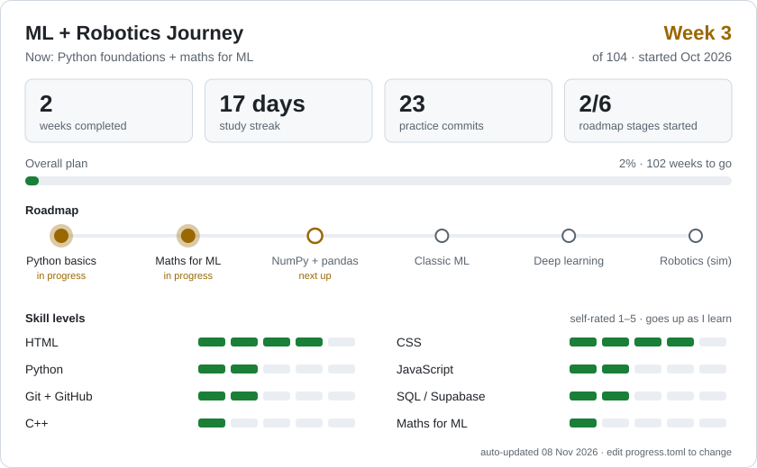
</picture></a>

<b>📓 Learning log: my latest practice commits</b>

<!--LOG:START-->
- `2026-11-13` · [Day05: Libraries](https://github.com/0001appiagyeisn/ml-journey/commit/86ab46b4f5131f099a01b1734752f8c03e5de391) in ml-journey
- `2026-11-12` · [Day 04 :Exceptions +loops](https://github.com/0001appiagyeisn/ml-journey/commit/1bb896007db4b21c4ca69ce51adb1ea27c876ca3) in ml-journey
- `2026-11-12` · [Day 3:Exceptions](https://github.com/0001appiagyeisn/ml-journey/commit/b429e233baacba9c35b9a37ecf94d7b5f8d402d7) in ml-journey
- `2026-11-12` · [Maths Stats](https://github.com/0001appiagyeisn/ml-journey/commit/f3b36df98f1a7ca282f5adf076c520fc79a121c6) in ml-journey
- `2026-11-12` · [Day 2:Till Stretch](https://github.com/0001appiagyeisn/ml-journey/commit/45b9a2fa90859b860be9b03de171ce3ecba8761f) in ml-journey
- `2026-11-11` · [Day 1&amp;2 :Till](https://github.com/0001appiagyeisn/ml-journey/commit/26d9a14604d2445f4cdc66a57d931163587c305c) in ml-journey
<!--LOG:END-->

## 🛠️ Tech stack

<a href="https://github.com/0001appiagyeisn/ml-journey"></a>

Also shipped with: Paystack (MoMo + card payments) and the Gemini API (AI product autofill).

## 🚀 Things I've built

  <a href="https://kdwisdomenterprise.com">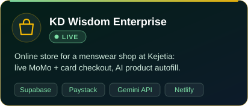</a>
  <a href="https://github.com/0001appiagyeisn/ml-journey/issues/new?title=Question%20about%20CampusMart">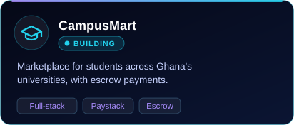</a>

  <a href="https://github.com/0001appiagyeisn/ml-journey/issues/new?title=Question%20about%20Study%20Squad">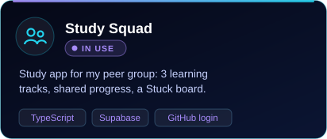</a>
  <a href="https://github.com/0001appiagyeisn/ml-journey/issues/new?title=Question%20about%20the%20ML%20Journey%20app">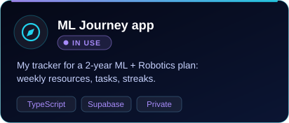</a>

  <a href="https://github.com/0001appiagyeisn/ml-journey">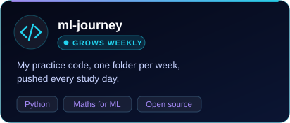</a>
  <a href="https://github.com/0001appiagyeisn/ml-journey/issues/new?title=Freelance%20enquiry">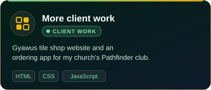</a>

Private projects open a quick message to me. Ask for a demo!

## 🏆 Achievements

<a href="progress.toml">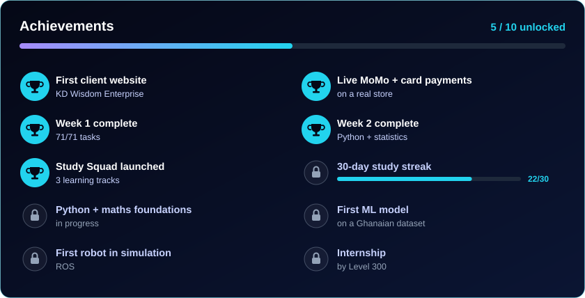</a>

## 📊 GitHub activity

  <a href="https://github.com/0001appiagyeisn"><picture>
    <source media="(prefers-color-scheme: dark)" srcset="https://streak-stats.demolab.com?user=0001appiagyeisn&exclude_days=Sat&theme=github-dark-blue&hide_border=true&background=00000000&ring=22D3EE&fire=A78BFA&currStreakLabel=22D3EE"/>
    
  </picture></a>

<!-- 3D calendar + snake: drawn by the daily Action. They switch on once GitHub Actions runs on this account.
<picture>
  <source media="(prefers-color-scheme: dark)" srcset="profile-3d-contrib/profile-night-green.svg"/>
  
</picture>

<picture>
  <source media="(prefers-color-scheme: dark)" srcset="https://raw.githubusercontent.com/0001appiagyeisn/0001appiagyeisn/output/github-snake-dark.svg"/>
  
</picture>
-->

## 🤝 Let's connect

I'm open to **freelance web projects**, **study collaborations**, and later **ML internships**. Message me on any of these:

  
  
  

  
  

<i>Medaase (thank you) for visiting! 🙏</i>

